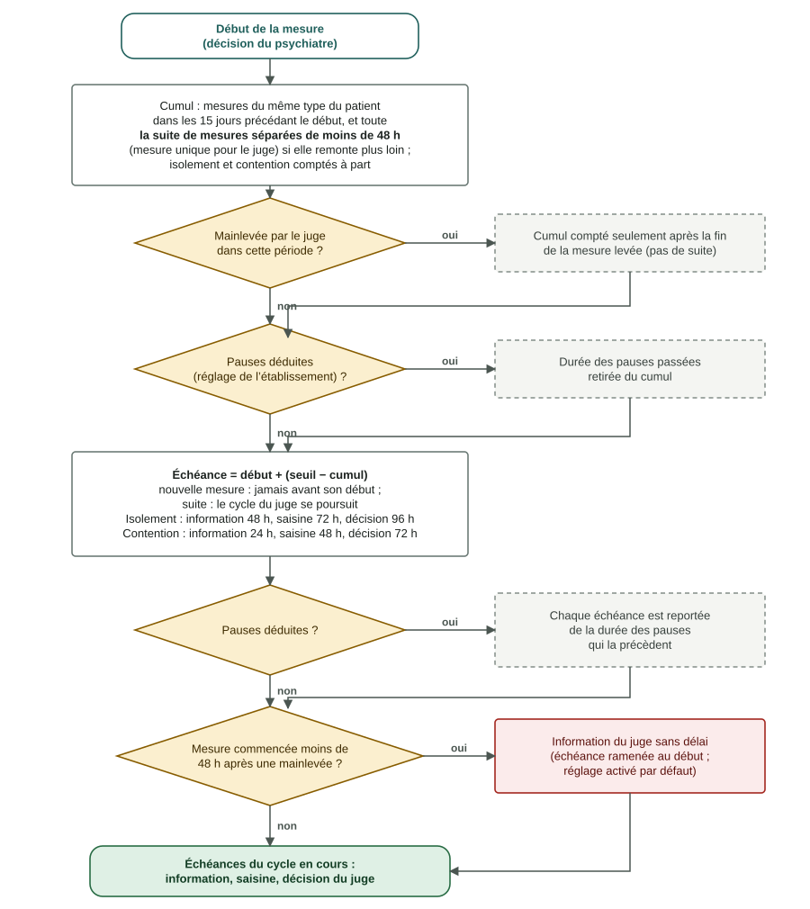
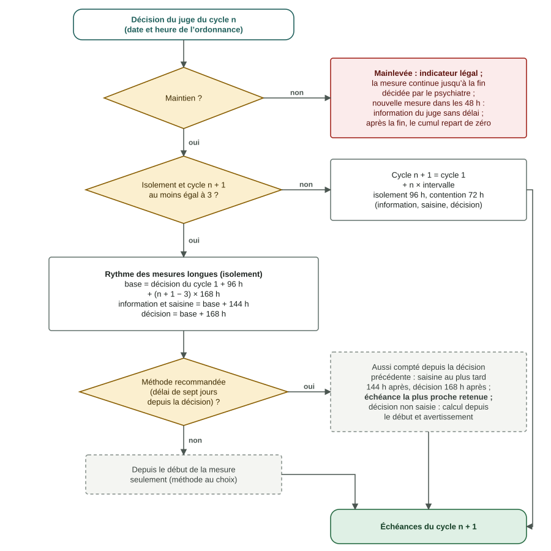
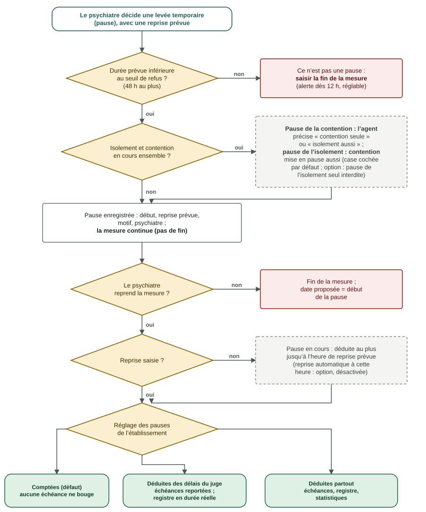
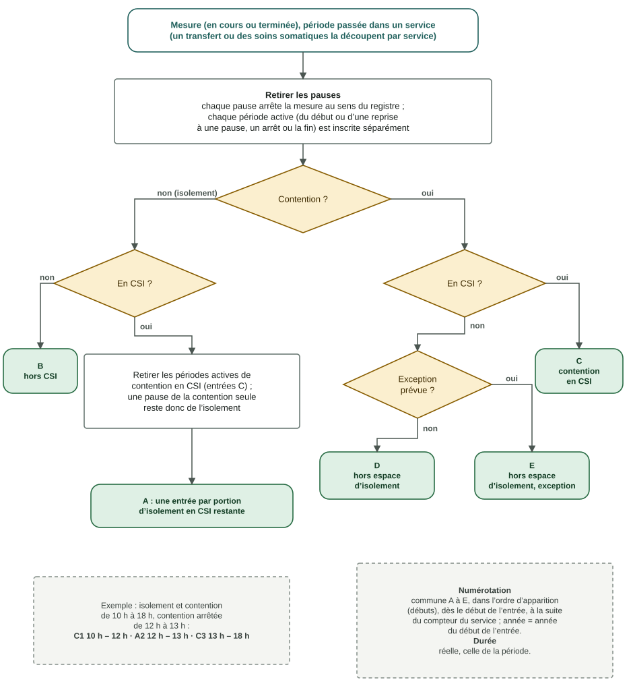
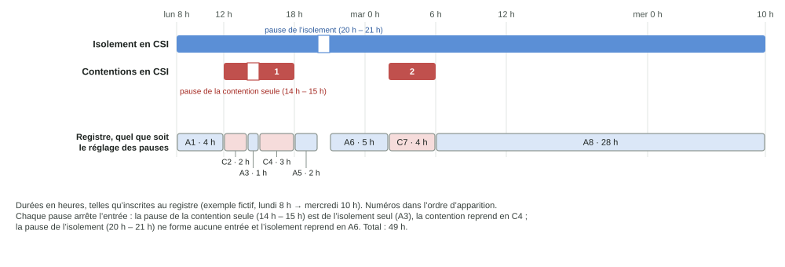

# Isolement et contention — calcul des durées, échéances du juge et inscription au registre

*Document de référence du module Isolement et contention de Tessera Santé (version 0.84). Il explique, règle par règle, comment l'outil calcule le cumul d'heures, les échéances d'information, de saisine et de décision du juge, et comment il inscrit chaque mesure au registre, y compris pour les mesures complexes (isolement et contention, pauses, reprises, arrêts). Destinataires : cadres de santé, psychiatres, IDE et secrétaires, direction des soins, département d'information médicale, direction juridique. Tous les exemples sont fictifs.*

Le « juge » est le magistrat du siège du tribunal judiciaire chargé du contrôle des mesures (anciennement juge des libertés et de la détention, JLD). La « chambre de soins intensifs » (CSI) est le lieu d'isolement dédié ; son nom se règle par l'établissement. Les règles appliquées découlent de l'article L. 3222-5-1 du code de la santé publique ; les choix laissés à l'établissement sont signalés, avec le réglage correspondant, dans Administration → Isolement et contention. Tessera calcule et rappelle : les décisions restent médicales et judiciaires, et le calcul est à vérifier en cas de doute.

## 1. Principes communs

- **Une mesure** commence et se termine sur décision du psychiatre ; l'IDE reporte ces décisions dans Tessera (début, pause, reprise, fin). L'isolement et la contention sont **deux mesures distinctes**, même lorsqu'elles se déroulent en même temps : chacune a sa durée, son cumul et ses échéances.
- **Les heures sont des heures réelles** : passage à l'heure d'été ou d'hiver compris (une nuit de 23 h ou de 25 h compte 23 h ou 25 h).
- **La mainlevée ordonnée par le juge** est un indicateur légal : elle ne termine pas la mesure dans l'outil. La fin reste une décision médicale, saisie comme telle.
- **Une mesure débutée ailleurs** (avant l'arrivée dans le service) : les délais du juge et les cumuls partent de la décision initiale ; le registre du service part de l'arrivée.
- **Un changement réel de lieu** termine la mesure et en commence une nouvelle au nouveau lieu. Une erreur de saisie se corrige, avec un motif.

## 2. Le cumul d'heures : 15 jours, et suite de mesures de moins de 48 h

Le cumul sert à calculer les échéances d'une mesure. Il compte, **pour le même patient et le même type de mesure** :

1. toutes les périodes de mesure du même type comprises dans les **15 jours glissants** qui précèdent le début de la nouvelle mesure ; une mesure ancienne à cheval sur cette fenêtre compte seulement pour sa partie incluse ;
2. et, si elle remonte plus loin, **toute la suite de mesures séparées de moins de 48 h** : une mesure prise moins de 48 h après la fin de la précédente forme avec elle **une mesure unique pour le juge** (art. L. 3222-5-1, II, et R. 3211-31, I, 2°, du code de la santé publique ; circulaire de la direction des affaires civiles et du sceau du 23 mars 2022). Les durées de la suite s'additionnent sans limite de 15 jours ; l'échéance la plus proche l'emporte. Une mesure prise 48 h ou plus après la précédente est une nouvelle mesure, qui ne garde que le cumul des 15 jours ;
3. **une seule fois** les périodes qui se chevauchent ;
4. **jamais avant la fin de la dernière mesure levée par le juge** : après une mainlevée, le cumul repart de zéro, même si une nouvelle mesure est prise moins de 48 h après (elle ne prolonge pas la mesure levée ; le juge en est informé sans délai, § 3) ;
5. **sans les pauses**, si l'établissement a choisi de déduire leur durée (§ 5) ; sinon les pauses restent comptées.

L'isolement et la contention ont chacun leur cumul et leur suite : une contention ne s'ajoute jamais au cumul de l'isolement, et inversement (les textes ne disent pas le contraire). **Le registre n'est pas concerné** : chaque mesure, et chaque période entre deux pauses, y garde son entrée (§ 6). Une contention en CSI ne suspend pas l'isolement qui l'accompagne : l'isolement continue de courir pour le juge.

**Exemples fictifs** (isolement débutant le lundi à 8 h) :

| Antécédents du patient dans les 15 jours | Cumul avant la mesure |
| --- | --- |
| Aucun | 0 h |
| Un isolement de 30 h terminé 10 h avant | 30 h |
| Un isolement de 30 h, dont 20 h dans la fenêtre de 15 jours | 20 h |
| Un isolement de 60 h, levé par le juge | 0 h (le cumul repart après la mesure levée) |
| Une contention de 6 h | 0 h pour l'isolement (la contention a son propre cumul) |
| Quatorze isolements de 4 h, un tous les jours et demi (32 h d'écart), sur 21 jours | 56 h : toute la suite compte, même au-delà de 15 jours |
| Les mêmes isolements, mais 48 h d'écart ou plus | seulement ceux des 15 derniers jours |

## 3. Les échéances du premier cycle

Chaque échéance est égale au **début de la mesure + (seuil − cumul)**. Pour une nouvelle mesure (48 h ou plus après la précédente), jamais avant son début. Pour une mesure d'une suite (moins de 48 h), l'échéance suit le temps de la suite et peut être déjà passée : elle a alors été traitée, ou doit l'être, sur la mesure précédente (§ 4).

| Seuils (cumul sur 15 jours) | Information du juge | Saisine du juge | Décision du juge |
| --- | --- | --- | --- |
| Isolement | 48 h | 72 h | 96 h |
| Contention | 24 h | 48 h | 72 h |

*Seuils fixés par la loi, modifiables seulement si les textes changent (Administration → Isolement et contention → Règles et pauses).*

**Exemples fictifs** (isolement débutant le lundi à 8 h) :

| Cumul avant la mesure | Information | Saisine | Décision |
| --- | --- | --- | --- |
| 0 h | mercredi 8 h (+ 48 h) | jeudi 8 h (+ 72 h) | vendredi 8 h (+ 96 h) |
| 30 h | mardi 2 h (+ 18 h) | mercredi 2 h (+ 42 h) | jeudi 2 h (+ 66 h) |
| 60 h | lundi 8 h (sans délai) | lundi 20 h (+ 12 h) | mardi 20 h (+ 36 h) |

Deux règles complètent le calcul :

- **Pauses déduites** : chaque échéance est reportée de la durée des pauses qui la précèdent (une pause d'une heure avant l'échéance la repousse d'une heure).
- **Nouvelle mesure moins de 48 h après une mainlevée** (art. L. 3222-5-1, II) : l'information du juge est due **sans délai** ; l'échéance d'information est ramenée au début de la mesure (réglage activé par défaut, *Cas particuliers*). Une alerte rouge le rappelle à la saisie.

*Logigramme 1 — Cumul (15 jours et suite de mesures) et échéances.*

## 4. Les cycles suivants et le délai de sept jours

Après une **décision de maintien**, la mesure passe au cycle suivant.

- **Cycles ordinaires** : les échéances du cycle n + 1 sont celles du cycle 1 décalées de n intervalles : **96 h pour l'isolement, 72 h pour la contention**.
- **Isolement, à partir du cycle 3** (après deux décisions de maintien) : rythme des mesures longues. Le cycle 3 part de la date prévue de décision du cycle 2 (décision du cycle 1 + 96 h) ; chaque cycle suivant ajoute 168 h. L'information et la saisine sont dues **144 h** après ce point de départ, la décision **168 h** après.
- **Délai de sept jours compté depuis la décision** (méthode recommandée, par défaut ; *Cas particuliers*) : à partir du cycle 3, le délai est compté aussi depuis l'heure de la **précédente décision du juge** (saisine au plus tard 144 h après, décision avant 168 h ; art. L. 3222-5-1, II ; Cour de cassation, avis du 6 mars 2024, n° 23-70.017), et **l'échéance la plus proche est retenue**. Aucune pause n'est déduite de ce délai. Si la décision précédente n'est pas saisie, le calcul part du début de la mesure et un avertissement s'affiche (« décision du cycle n à saisir »). Il faut saisir l'heure de l'ordonnance, à défaut celle de sa réception par courriel. L'autre méthode, au choix de l'établissement, compte toujours depuis le début de la mesure.
- **La contention** n'a pas de rythme des mesures longues : ses cycles se succèdent toutes les 72 h.
- **Suite de mesures (moins de 48 h)** : le cycle du juge **se poursuit** d'une mesure à l'autre. Une décision de maintien rendue sur la mesure précédente vaut pour la suivante, et les envois et décisions saisis sur les mesures précédentes de la suite comptent pour elle. Exemple fictif : isolement de 100 h, informé à 47 h, saisi à 70 h, maintenu par le juge à 90 h, puis arrêté ; nouvel isolement 10 h plus tard : il est au **cycle 2**, information due 44 h après son début (144 h de la suite, 100 h déjà faites), saisine 68 h, décision 92 h. Si l'isolement précédent s'était arrêté à 80 h, avant la décision, le nouvel isolement serait au cycle 1, information et saisine déjà faites, décision due 16 h après son début. Le décompte du juge montre alors toute la suite, même au-delà de 15 jours.

**Exemple fictif** (isolement débutant au temps 0, sans cumul ni pause, décision du cycle 2 rendue à 180 h) :

| Cycle | Information | Saisine | Décision | Avec le délai de sept jours |
| --- | --- | --- | --- | --- |
| 1 | 48 h | 72 h | 96 h | — |
| 2 | 144 h | 168 h | 192 h | — |
| 3 (mesures longues) | 336 h | 336 h | 360 h | 324 h, 324 h, 348 h (180 h + 144 h et + 168 h) |
| 4 | 504 h | 504 h | 528 h | calculé depuis la décision du cycle 3, une fois saisie |

| Contention, sans cumul | Information | Saisine | Décision |
| --- | --- | --- | --- |
| Cycle 1 | 24 h | 48 h | 72 h |
| Cycle 2 | 96 h | 120 h | 144 h |
| Cycle 3 | 168 h | 192 h | 216 h |

**Affichage des échéances** : « proche » 12 h avant (réglable), « dépassée » après l'heure, « faite » ou « faite en retard » une fois l'envoi saisi, et « sans objet » quand la mesure s'est terminée avant l'échéance.

**Après une mainlevée**, la mesure continue jusqu'à la fin décidée par le psychiatre ; une nouvelle mesure dans les 48 h impose l'information du juge sans délai (§ 3) ; après la fin de la mesure levée, le cumul repart de zéro (§ 2) et la nouvelle mesure ne forme pas une suite avec la mesure levée.

*Logigramme 2 — Cycles suivants et délai de sept jours.*

## 5. Les pauses (levées temporaires)

Une **pause** est une levée temporaire décidée par le psychiatre, avec une heure de reprise prévue. **Elle ne termine pas la mesure.**

- **Durée** : alerte au-delà de 12 h, refus au-delà de 48 h (réglables ; jamais plus de 48 h). Au-delà, ce n'est plus une pause : on saisit la fin de la mesure.
- **Isolement et contention en cours ensemble** :
  - pause de la **contention** : l'agent précise si elle concerne la contention seule ou aussi l'isolement ;
  - pause de l'**isolement** : la contention est mise en pause aussi (case cochée par défaut, alerte si elle est décochée) ; option de l'établissement : interdire la pause de l'isolement seul pendant une contention.
- **Reprise** : saisie à l'heure réelle. Sans reprise saisie, la pause n'est déduite que jusqu'à l'heure prévue (calcul prudent) ; la reprise automatique à cette heure est une option, désactivée par défaut. Si le psychiatre ne reprend pas la mesure, on saisit la fin, à la date du début de la pause.

**Deux réglages possibles** (*Règles et pauses*), tracés au journal. Ils ne concernent que le cumul et les échéances du juge :

| Réglage | Cumul et échéances du juge |
| --- | --- |
| **Pauses comptées** (défaut) | Inchangés : la pause compte comme du temps de mesure |
| **Pauses déduites des délais du juge** | Durée des pauses retirée du cumul ; échéances reportées d'autant |

Le choix « comptées » est le plus prudent : aucune échéance ne recule.

**Au registre et dans les statistiques, une pause est toujours un arrêt**, quel que soit le réglage : le registre ne connaît pas la levée temporaire. L'entrée s'arrête au début de la pause et la reprise ouvre une nouvelle entrée, avec un nouveau numéro (§ 6). Les versions 0.82 et antérieures proposaient aussi de déduire les pauses « partout » sans couper les entrées ; ce réglage a été retiré en 0.83 (décision du porteur du 16 novembre 2026).

*Logigramme 3 — Levée temporaire (pause).*

## 6. L'inscription au registre

Le registre (art. L. 3222-5-1) recense, par service et par année, chaque mesure avec l'identifiant du patient (IPP, identifiant permanent du patient) et son âge, le mode d'hospitalisation, le début, la durée, le psychiatre et les professionnels chargés de la surveillance.

### Catégories

| Catégorie | Mesure |
| --- | --- |
| **A** | Isolement en CSI (portions non couvertes par une contention en CSI) |
| **B** | Isolement hors CSI |
| **C** | Contention en CSI ; elle couvre l'isolement qui l'accompagne |
| **D** | Contention hors espace d'isolement |
| **E** | Contention hors espace d'isolement, exception prévue |

### Règles d'inscription

1. **Une période active, une entrée.** Une pause (levée temporaire) arrête la mesure au sens du registre : l'entrée se termine au début de la pause et la reprise ouvre une nouvelle entrée. Un **arrêt** de la mesure termine aussi son entrée. Une contention donne ainsi une entrée C, D ou E par période active ; un isolement hors CSI, une entrée B par période active.
2. **Isolement en CSI et contention en CSI** : les périodes actives de contention forment les entrées C ; l'isolement est inscrit en A **pour ses seules périodes actives sans contention** (avant, entre et après les contentions).
3. **Pause de la contention seule** (l'isolement continue) : la contention est arrêtée pendant la pause, le patient reste à l'isolement : ce temps forme une entrée A, puis la reprise de la contention une nouvelle entrée C. Exemple : isolement et contention de 10 h à 18 h, contention arrêtée de 12 h à 13 h : **C1** 10 h – 12 h, **A2** 12 h – 13 h, **C3** 13 h – 18 h. **Pause commune** à l'isolement et à la contention, ou **pause de l'isolement** : aucune entrée pendant la pause, une nouvelle entrée à la reprise.
4. **Transfert entre services, soins somatiques** : la mesure reste une pour le juge, mais le registre la répartit entre les services successifs ; une période de soins somatiques est inscrite au registre du service, à celui d'un service dédié, exclue (suspension), ou termine la mesure, selon le choix de l'établissement (*Cas particuliers*).
5. **Mode d'hospitalisation retenu** : le nouveau mode si le patient passe des soins libres à des soins sans consentement dans les 12 h suivant le début (délai réglable).
6. **Numérotation** commune aux catégories A à E, **dans l'ordre d'apparition** (ordre des débuts), attribuée **dès le début de l'entrée**, à la suite du compteur du service ; l'année est celle du début de l'entrée. Une mesure saisie après coup, débutée avant d'autres entrées de l'année, décale les numéros suivants : la note sous le registre le rappelle, et le **cadre** (pas les autres agents) est alerté après coup, dans *Aujourd'hui* pendant 7 jours et sous le registre, avec les numéros changés (« A12 → A13 ») ; un registre déjà présenté ou exporté est à rééditer.
7. **Durée** : durée réelle de la période, de son début (début de la mesure ou reprise) à sa fin (pause, arrêt ou fin de la mesure). Une colonne facultative « Levée temporaire » signale les entrées qui s'arrêtent pour une pause ou commencent à une reprise.
8. **Professionnels** : traces de surveillance par poste en CSI (catégories A et C), et hors CSI si l'établissement l'a choisi.

*Logigramme 4 — Inscription d'une mesure au registre.*

## 7. Exemple complet : isolement, contentions, pauses, reprises et arrêts

Patient fictif en CSI, soins sans consentement, aucune mesure dans les 15 jours précédents.

| Moment | Décision du psychiatre |
| --- | --- |
| Lundi 8 h | Début de l'isolement en CSI |
| Lundi 12 h | Début de la contention 1 en CSI (l'isolement continue) |
| Lundi 14 h | Pause de la contention seule, reprise prévue à 15 h (repas) |
| Lundi 15 h | Reprise de la contention |
| Lundi 18 h | Arrêt de la contention 1 (l'isolement continue) |
| Lundi 20 h | Pause de l'isolement, reprise prévue à 21 h (douche) |
| Lundi 21 h | Reprise de l'isolement |
| Mardi 2 h | Début de la contention 2 en CSI |
| Mardi 6 h | Arrêt de la contention 2 |
| Mercredi 10 h | Fin de l'isolement |

### Durées et échéances du juge

| Mesure | Pauses comptées | Pauses déduites des délais du juge |
| --- | --- | --- |
| Isolement : durée | 50 h | 49 h |
| Isolement : information, saisine, décision | mercredi 8 h, jeudi 8 h, vendredi 8 h | mercredi 9 h, jeudi 9 h, vendredi 9 h |
| Contention 1 : durée | 6 h | 5 h |
| Contention 1 : information | mardi 12 h (sans objet : arrêtée lundi 18 h) | mardi 13 h (sans objet) |
| Contention 2 : cumul avant | 6 h (contention 1) | 5 h |
| Contention 2 : information | mardi 2 h + 18 h = mardi 20 h (sans objet : arrêtée à 6 h) | mardi 2 h + 19 h = mardi 21 h (sans objet) |

L'isolement dure plus de 48 h : **l'information du juge est due** le mercredi à 8 h (ou à 9 h si les pauses sont déduites), avant la fin de la mesure à 10 h. La saisine et la décision sont sans objet, la mesure se terminant avant 72 h. Les contentions, plus courtes que 24 h de cumul, n'atteignent aucune échéance.

### Entrées du registre

Quel que soit le réglage des pauses, chaque pause arrête l'entrée en cours :

| N° | Catégorie | Période | Durée | Ce qui la termine |
| --- | --- | --- | --- | --- |
| **A1** | Isolement en CSI | lundi 8 h – 12 h | 4 h | début de la contention 1 |
| **C2** | Contention en CSI | lundi 12 h – 14 h | 2 h | pause de la contention |
| **A3** | Isolement en CSI | lundi 14 h – 15 h | 1 h | reprise de la contention |
| **C4** | Contention en CSI | lundi 15 h – 18 h | 3 h | arrêt de la contention 1 |
| **A5** | Isolement en CSI | lundi 18 h – 20 h | 2 h | pause de l'isolement |
| **A6** | Isolement en CSI | lundi 21 h – mardi 2 h | 5 h | début de la contention 2 |
| **C7** | Contention en CSI | mardi 2 h – 6 h | 4 h | arrêt de la contention 2 |
| **A8** | Isolement en CSI | mardi 6 h – mercredi 10 h | 28 h | fin de l'isolement |

La pause de la contention seule (14 h – 15 h) est de l'isolement seul (A3) ; la pause de l'isolement (20 h – 21 h) ne forme aucune entrée. Le registre totalise 49 h, la durée hors pauses de l'isolement ; pour le juge, en revanche, l'isolement dure 50 h si les pauses sont comptées.

*Logigramme 5 — Exemple : entrées du registre.*

## 8. Réglages de l'établissement concernés

| Réglage | Où | Défaut |
| --- | --- | --- |
| Seuils légaux (information, saisine, décision ; intervalles ; rythme long) | *Règles et pauses* | Valeurs de la loi |
| Pauses : activées, comptées ou déduites des délais du juge, seuils d'alerte et de refus, reprise automatique, pause de l'isolement seul interdite pendant une contention, colonne « Levée temporaire » au registre | *Règles et pauses* | Activées, comptées, 12 h / 48 h, reprise automatique désactivée, colonne affichée |
| Délai de sept jours | *Cas particuliers* | Compté aussi depuis la décision précédente |
| Information sans délai après une mainlevée (48 h), toute mesure ou même type | *Cas particuliers* | Activée, toute nouvelle mesure |
| Soins somatiques ou urgences | *Cas particuliers* | Mesure poursuivie au registre du service |
| Délai de bascule du mode d'hospitalisation | *Règles et pauses* | 12 h |
| Seuil d'affichage « proche » | *Règles et pauses* | 12 h |

---

*Les règles décrites sont celles des fichiers `app/js/rules.js` et `app/js/model.js` ; les exemples ont été calculés par l'outil lui-même. Logigrammes produits par `scripts/logigrammes-calculs.py`. Pour toute question d'interprétation d'un texte, la direction juridique et le greffe du tribunal font foi.*
